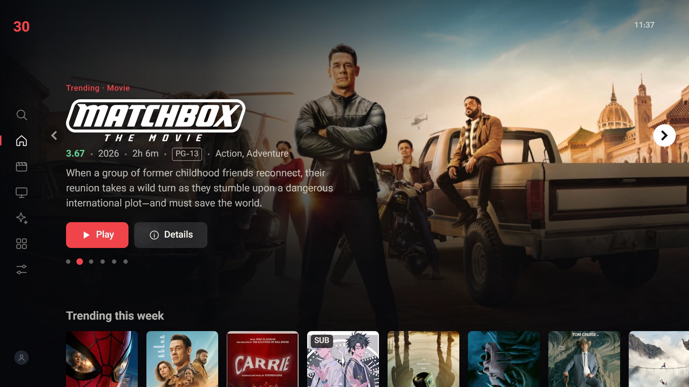
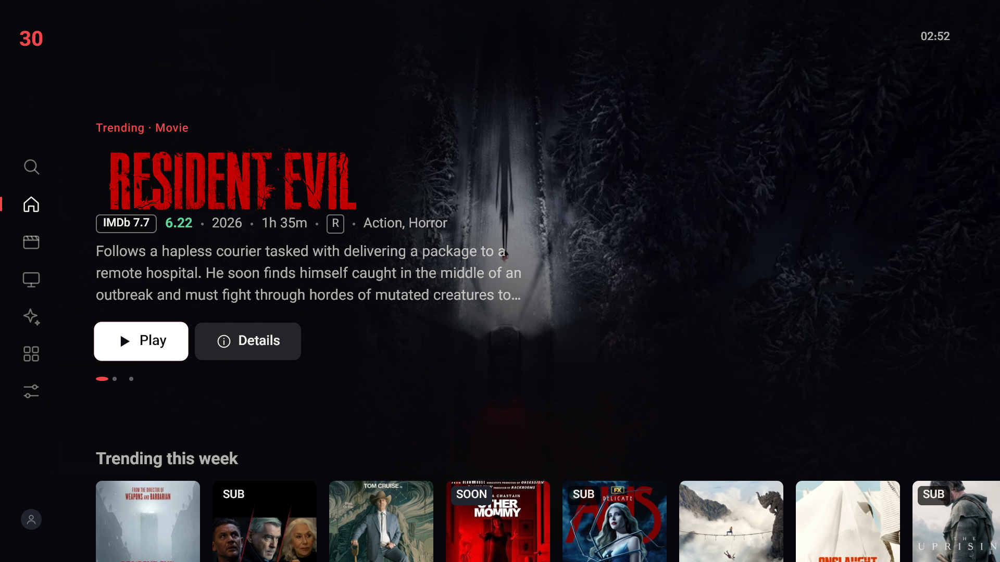
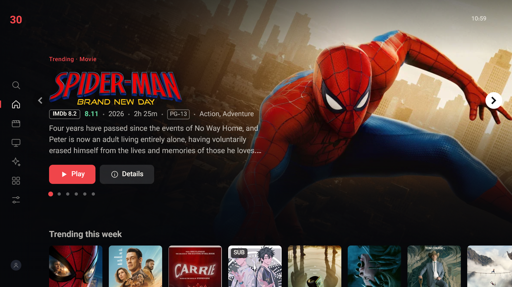
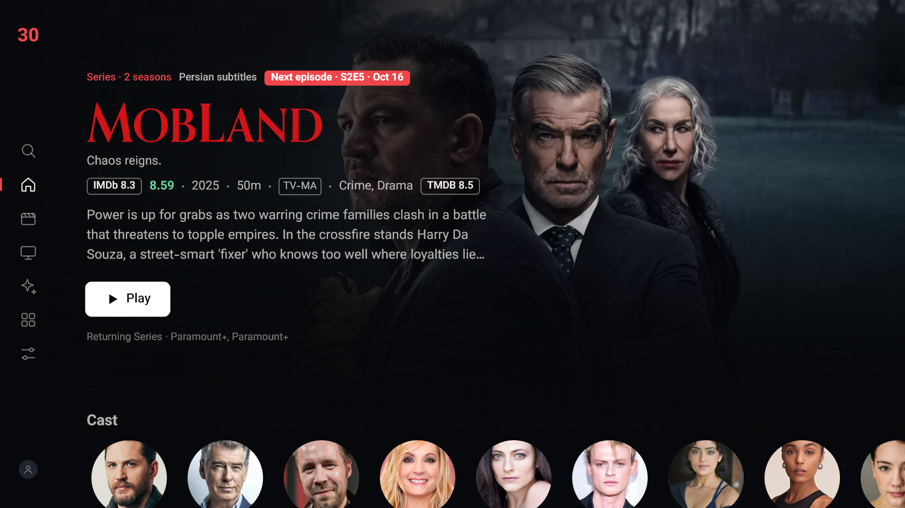
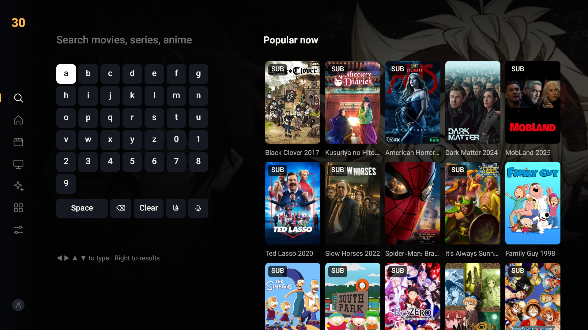

# 30nama for Samsung Tizen TV

A Netflix-style Samsung Tizen TV app: an unofficial client for your own 30nama.com subscription.



> **Disclaimer:** This is an unofficial, community project. It is not affiliated with, endorsed by, or supported by 30nama. You need your own valid 30nama subscription to use it. No content is bundled with this app.

## Features

- Sign in by scanning a QR code with your phone (no typing on the remote)
- Netflix-style TV UI: hero banner, rows, details pages, search, remote-friendly navigation
- Samsung AVPlay player with HLS playback at the highest available quality
- Persian (fa) and English (en) subtitles
- Persian UI with full right-to-left support (Vazirmatn font)
- Optional TMDB enrichment: trending rows, cast and crew, reviews, recommendations

## Screenshots

| Home | Browse |
|---|---|
|  |  |
| **Details** | **Search** |
|  |  |

## Requirements

- A Samsung Tizen TV (2018 or newer recommended) on the same network as your PC
- [Tizen Studio](https://developer.tizen.org/development/tizen-studio/download) with the CLI tools and the TV extension
- A Samsung developer certificate that includes your TV's DUID
- Git Bash or another bash shell (the scripts target Windows + Git Bash; paths use `TIZEN_HOME`, default `/c/tizen-studio`)

## Install on your TV

1. On the TV, enable Developer Mode: open Apps, type `12345`, switch Developer mode on and enter your PC's IP address. Reboot the TV.
2. Run the guided setup, which connects to the TV, reads its DUID and walks you through creating a certificate and security profile:
   ```
   ./install-wizard.sh
   ```
   It stores your answers in `.wizard.env` (git-ignored).
3. Or build and install manually:
   ```
   ./build.sh <security-profile> [<tv-ip>:26101]
   ```
   Without a target it only produces a signed `.wgt` in `dist/`. With a target it also installs and launches the app.

## Optional: TMDB setup

TMDB adds trending rows, cast, reviews and recommendations. It is off by default and the app works fully without it.

1. Create a free account at themoviedb.org and copy your **API Read Access Token** (v4) from Settings, API.
2. Copy the example file and paste the token:
   ```
   cp tizen-app/js/tmdb-token.example.js tizen-app/js/tmdb-token.js
   ```
   `tmdb-token.js` is git-ignored. If you skip this, `build.sh` and the dev server simply run with TMDB disabled.

This product uses the TMDB API but is not endorsed or certified by TMDB.

## Development

Run the app in a desktop browser with a small proxy (no dependencies, Node 18+):

```
cd tizen-app
node tools/devserver.js 8080
```

Then open http://localhost:8080/. The proxy forwards API and HLS requests to avoid CORS. See `tizen-app/README.md` for developer notes and `design/DESIGN.md` for the design spec.

## Structure

```
tizen-app/    the Tizen web app (config.xml, index.html, js/, css/, fonts/, tools/)
design/       design spec
docs/images/  README screenshots
media/        poster
build.sh      build, sign and install
install-wizard.sh  guided TV setup
```

## License

All rights reserved for now. The Vazirmatn font in `tizen-app/fonts/` is licensed under the SIL Open Font License (see `tizen-app/fonts/OFL.txt`).
